# YOONCHANGWOOK_TACXI

**Table Automatic Creation & data eXport/Import**  
테이블 자동 생성 및 데이터 적재·추출 프로그램

## 프로젝트 개요

MySQL 환경에서 초기 데이터를 적재하고 테이블 데이터를 CSV 파일로 추출하는 과정을 간소화하기 위한 프로그램입니다. 사전에 정의한 테이블 정의를 바탕으로 MySQL 테이블을 자동 생성하고, CSV 파일의 데이터를 일괄 적재하며, 기존 테이블의 데이터를 CSV 파일로 내보내는 기능을 제공합니다.

## 주제 선정 배경

MySQL에서 초기 데이터를 적재하려면 테이블을 직접 생성하고, CSV 파일의 구조에 맞춰 데이터를 입력하는 작업이 필요합니다. 또한, 테이블 데이터를 CSV 파일로 추출하는 과정에서도 별도의 명령어와 설정이 요구되어 사용에 불편함이 있었습니다.

이러한 반복 작업을 줄이고 데이터 적재와 추출을 보다 편리하게 수행할 수 있도록 본 주제를 선정했습니다.

## 기획 의도

테이블 생성부터 데이터 적재·추출까지의 과정을 자동화하여, 사용자가 복잡한 SQL 명령어를 반복해서 작성하는 부담을 줄이는 것을 목표로 합니다. 사전에 정의한 테이블 구조를 활용해 일관된 형식으로 데이터를 관리하고, CSV 파일과 MySQL 간의 데이터 이동을 간소화하고자 합니다.

## 🚀 프로젝트 실행 방법
1) 사전 준비
항목	내용
JDK	21
IDE	IntelliJ IDEA
DB	MySQL (본인 PC에 설치)
빌드 도구	Gradle (프로젝트에 포함된 `gradlew` 사용)
2) 프로젝트 내려받기
```bash
git clone https://github.com/20260921-saltlux-llm-agent-service-2nd/YOONCHANGWOOK_TACXI.git
```
IntelliJ에서 `File > Open`으로 내려받은 폴더를 열고, Gradle 동기화가 끝날 때까지 기다립니다.
3) DB 준비 (로컬 MySQL)
본인 PC의 MySQL에 접속해 아래 SQL을 순서대로 실행합니다.
① 데이터베이스와 계정 생성
```sql
CREATE DATABASE 사용할DATABASE DEFAULT CHARACTER SET utf8mb4;

CREATE USER '사용할 계정'@'localhost' IDENTIFIED BY '사용할 비밀번호';
GRANT ALL PRIVILEGES ON 사용할DATABASE.* TO '사용할계정'@'localhost';
FLUSH PRIVILEGES;
```
② 회원 테이블 생성
```sql
create table 사용할DATABASE.tb_member
(
    MEMBER_SQNO int auto_increment
        primary key,
    MEMBER_ID   varchar(20)                        null,
    PHONE       varchar(20)                        null,
    PWD         varchar(20)                        not null,
    LSCHG_DTM   datetime default CURRENT_TIMESTAMP null
);
```
③ 테이블 정의서 저장 테이블 생성
```sql
create table 사용할DATABASE.tb_gen_man_mntr_table
(
    GEN_MNTR_SQNO bigint auto_increment,
    MEMBER_SQNO   int                                not null,
    TABLE_NAME    varchar(200)                       not null,
    COL_DATA_TYPE varchar(200)                       null,
    COLUMN_NM     varchar(200)                       not null,
    COLUMN_SIZE   varchar(200)                       null,
    NULL_YN       char                               not null,
    PK_YN         char                               null,
    FK_YN         char                               null,
    REF_TABLE_NM  varchar(200)                       null,
    REF_COLUMN    varchar(100)                       null,
    DEFAULT_STR   varchar(200)                       null,
    COMMENT       varchar(200)                       null,
    LSCHG_DTM     datetime default CURRENT_TIMESTAMP null,
    primary key (GEN_MNTR_SQNO, TABLE_NAME),
    constraint FK_TB_MEMBER_TO_TB_GEN_MAN_MNTR_TABLE_1
        foreign key (MEMBER_SQNO) references tacxi_db.tb_member (MEMBER_SQNO)
);

create index IDX_GEN_MNTR_MEMBER_SQNO
    on 사용할DATABASE.tb_gen_man_mntr_table (MEMBER_SQNO);
```
> ❗ `tb_member`를 먼저 만들어야 합니다. `tb_gen_man_mntr_table`이 `tb_member`를 참조(FK)하므로 순서가 바뀌면 오류가 납니다.
4) DB 접속 정보 설정
`src/main/resources/db.properties` 파일을 아래 내용으로 작성합니다.
```properties
driver=com.mysql.cj.jdbc.Driver
url=jdbc:mysql://localhost:3306/사용할DATABASE
user=사용할 계정
password=사용할 비밀번호
```
5) 프로그램 실행
IntelliJ에서 `src/main/java/app/run/Application.java`를 열고 `main` 메서드를 실행합니다.
> ❗ 실행 위치(Working directory)가 프로젝트 최상위 폴더여야 합니다. IntelliJ 기본 설정이면 그대로 두면 됩니다.
6) 사용 순서
초기화면에서 1. 회원가입으로 계정을 만듭니다.
2. 로그인으로 로그인합니다.
1. 테이블 생성에서 테이블 정의서 CSV의 경로와 테이블명을 입력해 테이블을 만듭니다. (정의서 저장 방법은 테이블 생성 참고)
> 테이블정의서 경로:YOONCHANGWOOK_TACXI/TableDefintionDOC/TableDefinitonDOC_Sample.csv
3. 테이블 조회에서 생성된 테이블을 확인하고 DATA LOAD(CSV → DB) 또는 DATA UNLOAD(DB → CSV)를 실행합니다.


## 프로그램 구조

프로그램은 테이블 생성, 데이터 적재, 데이터 추출 기능으로 구성됩니다.
프로젝트 아키텍처 구조도
1. 전체 파일 구조
```text
src/main
├── java
│   └── app
│       ├── common
│       │   └── JDBCTemPlate.java           # DB 연결 및 JDBC 자원 관리 등 공통 기능 제공
│       │
│       ├── controller
│       │   ├── DL_Controller.java          # 데이터 Load 기능 실행 흐름 제어
│       │   ├── DUL_Controller.java         # 데이터 UnLoad 기능 실행 흐름 제어
│       │   ├── TG_TableGenController.java  # 사용자 정의서 등록 및 정의서 기반 테이블 생성 제어
│       │   └── UserController.java         # 회원가입 및 로그인 처리 제어
│       │
│       ├── model
│       │   └── DTO
│       │       ├── DL_SelectColNmDTO.java  # 데이터 적재·추출에 필요한 컬럼 정보 전달
│       │       ├── TG_TableDefDto.java     # 사용자 정의서의 테이블 및 컬럼 정의 정보 전달
│       │       └── UserDto.java            # 회원 정보 전달
│       │
│       ├── repository
│       │   ├── DL_Repository.java          # 데이터 Load 관련 SQL 실행 및 DB 작업
│       │   ├── DUL_Repository.java         # 데이터 추출 관련 SQL 실행 및 DB 작업
│       │   ├── TG_TabelGenRepository.java  # 테이블 정의서 조회 및 테이블 생성 DDL 실행
│       │   └── UserRepository.java         # 회원 정보 조회 및 회원 관련 DB 작업
│       │
│       ├── run
│       │   └── Application.java            # 프로그램 진입점 및 전체 메뉴 흐름 관리
│       │
│       └── view
│           ├── DL_view.java                # 데이터 적재 관련 사용자 입력 및 결과 출력
│           ├── TG_TableView.java           # 테이블 정의서 입력 및 테이블 생성 관련 입출력
│           └── UserView.java               # 회원가입 및 로그인 관련 사용자 입출력
│   
└── resources
    ├── db
    │   └── mapper
    │       ├── DL_InsertTable.xml          # 데이터 적재 관련 SQL 정의
    │       ├── DL_SelectColNm.xml          # 데이터 적재·추출에 필요한 컬럼 조회 SQL 정의
    │       ├── DUL_SelectAllFromTable.xml  # 테이블 데이터 추출 관련 SQL 정의
    │       ├── TG_DefinitionInsert.xml     # 사용자 정의서 데이터를 저장하는 SQL 정의
    │       ├── TG_TableCreate.xml          # 사용자 정의서 조회 등에 사용하는 SQL 정의
    │       └── UserSelect.xml              # 회원 조회 관련 SQL 정의
    │
    └── db.properties
```
---
2. 전체 핵심 메소드 연결 관계
2.1 CSV 기반 테이블 생성
```text
createTablesFromCsv()
        │
        ├── 기존 정의서 중복 여부 체크 후 삭제
        │
        ├── readCsv()
        │      └── CSV 정의서 DB 등록
        │
        └── createTables()
               │
               ├── findDefinitions()
               │      └── 정의서 상세 조회
               │
               ├── groupByTable()
               │      └── 테이블별 정의서 그룹화
               │
               ├── buildCreateTable()
               │      └── CREATE TABLE DDL 조립
               │
               └── execute()
                      └── 실제 DB 테이블 생성
```
2.2 데이터 LOAD
```text
StartDL_Controller()
        │
        ├── selectColnmDTOList()
        │      └── 대상 테이블 컬럼 조회
        │
        └── DL_Start()
               └── Loadcsv()
                      └── CSV 데이터 적재
```
2.3 데이터 UNLOAD
```text
StartDUL_Controller()
        │
        ├── selectColnmDTOList()
        │      └── 대상 테이블 컬럼 조회
        │
        └── DataUnload()
               └── DB 데이터를 CSV 파일로 내보내기
```
2.4 로그인
```text
login()
   │
   ├── selectMemberByMemberId()
   │      └── 회원 정보 조회
   │
   ├── 아이디 및 비밀번호 검증
   │
   └── loginUser 저장
          │
          └── getLoginUser()
                 └── 로그인 정보 제공
```
---
3. 핵심 메소드 요약
기능 구분	핵심 메소드	핵심 역할
로그인	`login()`	사용자 인증 및 로그인 정보 저장
로그인 정보 제공	`getLoginUser()`	로그인 사용자 정보 반환
정의서 목록 조회	`usercreatedTables()`	사용자별(ID) 테이블 정의서 목록 조회
정의서 상세 조회	`findDefinitions()`	테이블 생성에 필요한 상세 정의(컬럼 정보) 조회
CSV 정의서 등록	`readCsv()`	CSV 데이터를 정의서 테이블에 저장
테이블별 그룹화	`groupByTable()`	테이블명 기준으로 컬럼 정보 분류
DDL 조립	`buildCreateTable()`	사용자 기반 정의서를 DDL 쿼리문으로 변환
DDL 실행	`execute()`	실제 DB 테이블 생성 SQL 실행
CSV 기반 테이블 생성	`createTablesFromCsv()`	정의서 삭제·등록·테이블 생성 통합
데이터 LOAD	`StartDL_Controller()`	CSV 데이터의 대상 컬럼 DB 적재 제어
데이터 UNLOAD	`StartDUL_Controller()`	DB 데이터의 대상 컬럼 CSV 내보내기 제어
---
3. 아키텍처 요약
```text

┌─────────────────────────────────────────────────────────────┐
│                       Application                           │
│  프로그램 실행 및 메뉴 관리                                   │
│  사용자 입력 및 처리 결과 출력                                │
└────────────────────────────┬────────────────────────────────┘
                             │ 요청 전달
                             ▼
┌─────────────────────────────────────────────────────────────┐
│                      Controller 계층                         │
│  UserController  /  DL_Controller                           │
│  DUL_Controller  /  TG_TableGenController                   │
│  입력 검증, 기능 실행 순서 제어, 결과 반환                     │
└───────────────┬─────────────────────────────┬───────────────┘
                │                             │
                ▼                             ▼
┌──────────────────────────┐    ┌────────────────────────────┐
│        Model / DTO       │    │      Repository 계층        │
│                          │    │                            │
│  UserDto                 │    │  UserRepository            │
│  DL_SelectColnmDTO       │    │  DL_Repository             │
│  TG_TableDefDto          │    │  DUL_Repository            │
│                          │    │  TG_TableGenRepository     │
│  계층 간 데이터 전달      │    │  DB 작업 및 CSV 입출력       │
└──────────────────────────┘    └──────────────┬─────────────┘
                                              │
                         ┌────────────────────┴──────────────────┐
                         │                                       │
                         ▼                                       ▼
              ┌─────────────────────┐                ┌─────────────────────┐
              │  SQL XML Mapper     │                │  DB 연결 설정        │
              │                     │                │                     │
              │  UserSelect.xml     │                │  db.properties      │
              │  DL_SelectColNm.xml │                │  접속 정보 관리      │
              │  DL_InsertTable.xml │                └──────────┬──────────┘
              │  DUL_SelectAll...xml│                           │
              │  TG_Definition...xml│                           │
              │  TG_TableCreate.xml │                           │
              └──────────┬──────────┘                           │
                         └──────────────────┬────────────────────┘
                                            ▼
                                  ┌─────────────────────┐
                                  │      Database       │
                                  │                     │
                                  │  회원 정보 조회      │
                                  │  데이터 저장·조회    │
                                  │  테이블 정의서 저장  │
                                  │  테이블 생성        │
                                  └─────────────────────┘

[공통 DB 처리]
  JDBCTemplate
    └─ DB 연결 및 JDBC 자원 관리
```

```text
테이블 생성
사전 정의된 테이블 정의 → MySQL 테이블 생성

데이터 적재(Import)
CSV 파일 → 데이터 읽기 → 대상 MySQL 테이블에 일괄 적재

데이터 추출(Export)
MySQL 테이블 → 데이터 조회 → CSV 파일 생성 및 저장
```

## 주요 내용 및 기능

프로그램 단계를 Lv1(시작 화면), Lv2(초기 메뉴), Lv3(로그인 후 메뉴), Lv4(세부 기능)로 구분합니다. `—`는 해당 단계가 없음을 의미합니다. 각 단계의 링크를 클릭하면 아래의 해당 실행 화면으로 이동합니다.

| Lv1 | Lv2 | Lv3 | Lv4 | 설명 |
| --- | --- | --- | --- | --- |
| [초기화면](#초기화면) | [1. 회원가입](#회원가입) | — | — | 아이디, 비밀번호, 전화번호를 입력받아 회원 테이블에 저장합니다. |
| [초기화면](#초기화면) | [2. 로그인](#로그인) | — | — | 아이디와 비밀번호로 로그인합니다. |
| [초기화면](#초기화면) | [9. 프로그램 종료](#프로그램-종료) | — | — | 프로그램을 종료합니다. |
| [초기화면](#초기화면) | [2. 로그인](#로그인) | [1. 테이블 생성](#테이블-생성) | [테이블 자동 생성](#테이블-생성) | 테이블 정의서의 저장 경로를 입력받고, 정의서의 테이블명·칼럼명·자료형·크기 등을 바탕으로 MySQL 테이블을 생성합니다. |
| [초기화면](#초기화면) | [2. 로그인](#로그인) | [1. 테이블 생성](#테이블-생성) | [DATA LOAD 연동](#data-load-연동) | 테이블 생성 후 적재 여부를 확인합니다. Y를 선택하면 생성한 테이블의 물리명을 LOAD 기능에 전달하고, N을 선택하면 최초 화면으로 돌아갑니다. |
| [초기화면](#초기화면) | [2. 로그인](#로그인) | [2. 테이블 조회](#테이블-조회) | [생성 테이블 목록 조회](#생성-테이블-목록) | 로그인한 사용자가 생성한 테이블 목록을 확인합니다. |
| [초기화면](#초기화면) | [2. 로그인](#로그인) | [2. 테이블 조회](#테이블-조회) | [DATA LOAD (Import)](#data-load) | 테이블 물리명과 CSV 파일 경로를 입력받아 대상 테이블에 데이터를 일괄 적재합니다. |
| [초기화면](#초기화면) | [2. 로그인](#로그인) | [2. 테이블 조회](#테이블-조회) | [DATA UNLOAD (Export)](#data-unload) | 테이블 존재 여부를 확인한 뒤 전체 데이터를 CSV 파일로 추출합니다. 성공 시 저장 경로를 안내하고, 실패 시 실패 메시지를 출력합니다. |
| [초기화면](#초기화면) | [2. 로그인](#로그인) | [2. 테이블 조회](#테이블-조회) | [이전 화면으로 복귀](#테이블-조회) | 테이블 조회 후 이전 테이블 조회 화면으로 돌아갑니다. |


## 개발 환경

| 항목 | 사용 환경 |
| --- | --- |
| 개발 언어 | Java |
| 개발 도구 | IntelliJ IDEA |
| 운영체제 | Windows |
| 데이터베이스 | MySQL |
| 데이터 입출력 형식 | CSV |

## 팀 R&R

| 팀원 | 담당 영역 | 담당 업무 및 역할 | 관련 이슈 |
| --- | --- | --- | --- |
| 이창열 | 회원 관리 | 아이디·비밀번호 기반 로그인, 로그아웃, 회원가입 및 회원 정보(아이디, 비밀번호, 휴대전화 번호) 저장 기능 구현 | FR-001-01, FR-001-02, FR-001-03 |
| 김영욱 | 테이블 생성 및 조회 | 고정 양식의 테이블 정의서를 바탕으로 CREATE TABLE 구문 생성 및 실행, 생성 후 데이터 적재 여부 확인 및 LOAD 기능 연동, 로그인한 사용자가 생성한 테이블 조회와 이전 화면 복귀 기능 구현 | FR-002-01, FR-002-02, FR-003-01 |
| 임종윤 | 데이터 적재 및 추출 | 테이블 물리명과 CSV 파일 경로를 입력받아 데이터 LOAD 수행, UNLOAD 전 테이블 존재 여부 확인, 테이블 전체 데이터를 CSV로 추출하고 저장 경로 및 성공·실패 메시지 출력 | FR-003-02, FR-003-03-01, FR-003-03-02 |

테이블 생성·조회 및 데이터 적재·추출 기능은 로그인한 사용자에게 제공됩니다. 테이블 생성 후 적재를 선택하면 생성된 테이블의 물리명을 LOAD 기능에 전달하며, 적재를 선택하지 않으면 최초 화면으로 돌아갑니다.

## 기대 효과

- 반복적인 테이블 생성과 데이터 입출력 작업을 자동화하여 작업 시간을 줄입니다.
- 수작업에 따른 오류를 줄이고 일관된 테이블 구조로 데이터를 관리할 수 있습니다.
- CSV 파일을 활용한 데이터 이동을 간소화하여 MySQL 데이터 관리의 편의성과 효율성을 높입니다.

## 실행 화면

각 기능의 실행 화면입니다. 이미지는 README.md와 같은 위치의 `images` 폴더에 저장되어 있습니다.

### 초기화면

회원가입, 로그인, 프로그램 종료를 선택하는 시작 화면입니다.

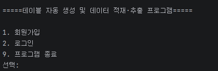

[기능 표로 돌아가기](#주요-내용-및-기능)

### 회원가입

아이디, 비밀번호, 전화번호를 입력하는 화면입니다.

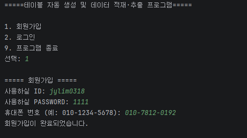

[기능 표로 돌아가기](#주요-내용-및-기능)

### 로그인

아이디와 비밀번호를 입력하는 화면입니다.

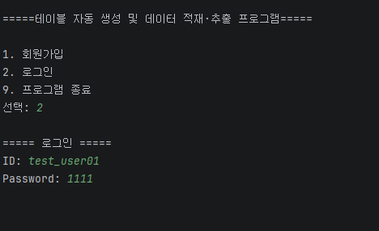
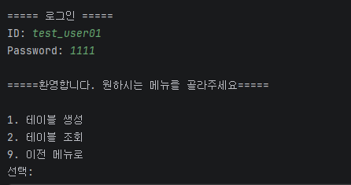

[기능 표로 돌아가기](#주요-내용-및-기능)

### 프로그램 종료

프로그램 종료 결과 화면입니다.

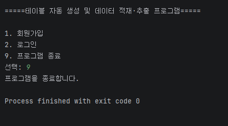

[기능 표로 돌아가기](#주요-내용-및-기능)

### 테이블 생성

테이블 정의서 경로를 입력하고 테이블 생성 결과를 확인하는 화면입니다.


#### 1) 테이블정의서 작성 -  생성하길 원하는 테이블의 정의서를 작성합니다.(테이블명,자료형,칼럼명,자료형의 크기,NULL여부,PK여부,FK여부,참조테이블,참조키,디폴트값,커멘트)
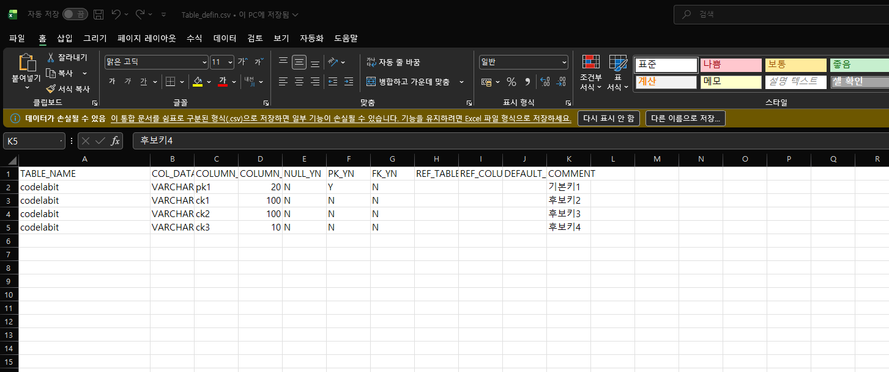
##### ❗ **반드시 `CSV UTF-8(쉼표로 분리)(*.csv)` 형식으로 저장하세요.**
> 프로그램이 Java FileReader의 UTF-8 인코딩으로 정의서를 읽기 때문에, 다른 형식으로 저장하면 한글이 깨져 정상적으로 등록되지 않을 수 있습니다.
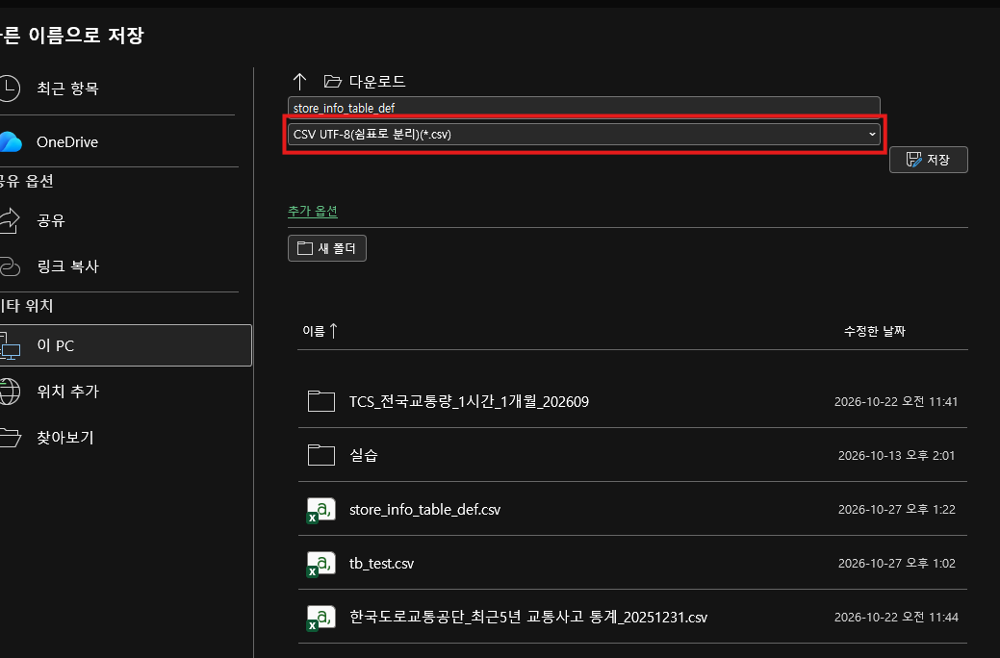
#### 2) 경로입력 -  테이블 정의서가 작성된 경로를 입력해주세요
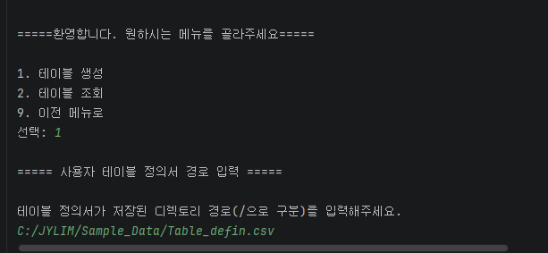
#### 3) 테이블명 입력 -  테이블 정의서에 입력한 테이블명을 동일하게 입력한후 enter로 실행해주세요
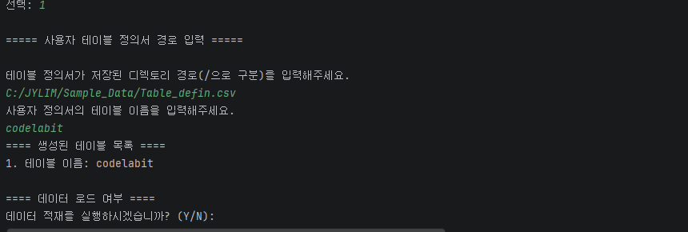

#### ✅ 테이블이 생성된 모습
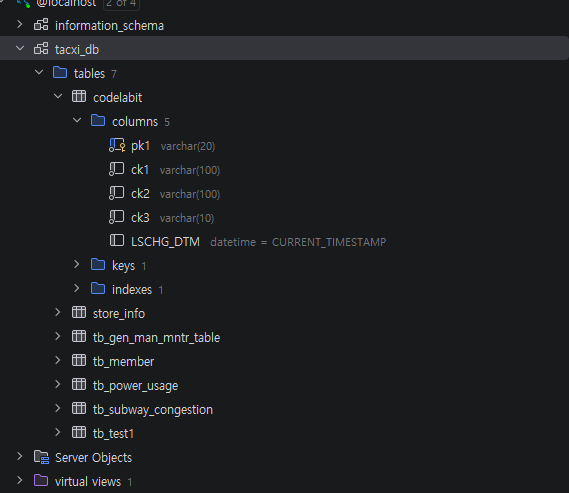

[기능 표로 돌아가기](#주요-내용-및-기능)

### DATA LOAD 연동

테이블 생성 후 데이터 적재 여부를 선택하는 화면입니다.

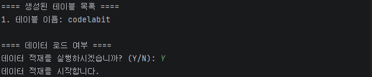

#### DATA LOAD 연동여부를 선택하면 DATA_LOAD를 진행할 수 있습니다.
[DATA LOAD (Import)](#data-load)

[기능 표로 돌아가기](#주요-내용-및-기능)

### 테이블 조회

생성 테이블 조회와 DATA LOAD·UNLOAD를 선택하는 메뉴 화면입니다.

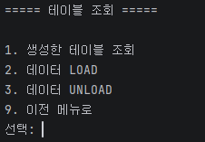

[기능 표로 돌아가기](#주요-내용-및-기능)

### 생성 테이블 목록

로그인한 사용자가 생성한 테이블 목록을 확인하는 화면입니다.


#### 1) 검색을 원하는 ID를 입력합니다.
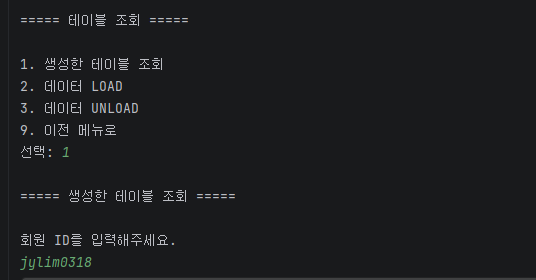
#### ✅ 생성된 테이블이 조회된 모습
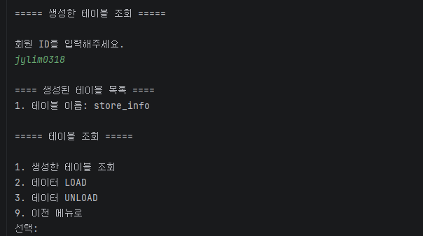


[기능 표로 돌아가기](#주요-내용-및-기능)

### DATA LOAD

테이블 물리명과 CSV 파일 경로를 입력하고 데이터 적재 결과를 확인하는 화면입니다.

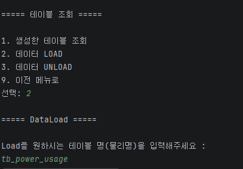
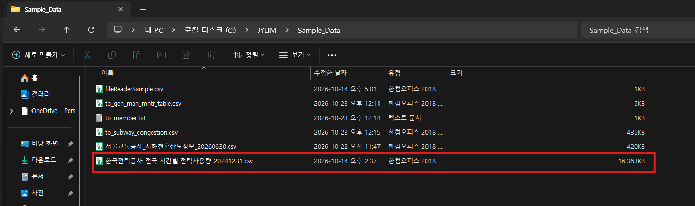
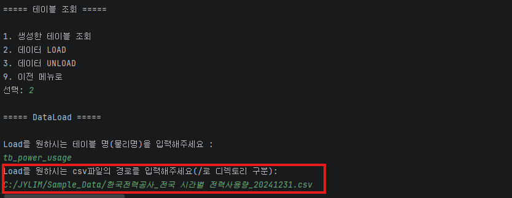
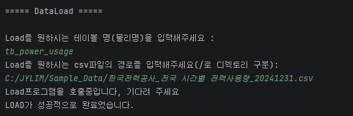


[기능 표로 돌아가기](#주요-내용-및-기능)

### DATA UNLOAD

데이터 추출 결과와 CSV 파일 저장 경로를 확인하는 화면입니다.

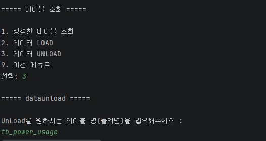
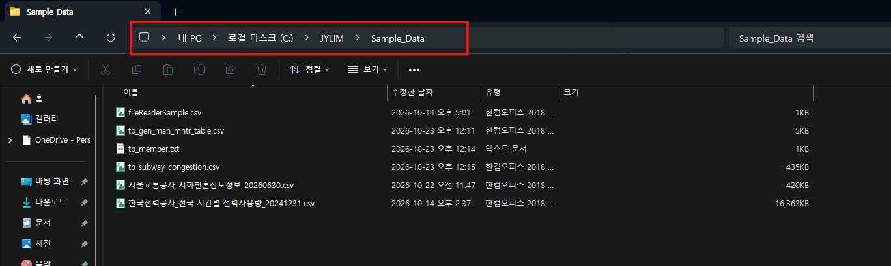
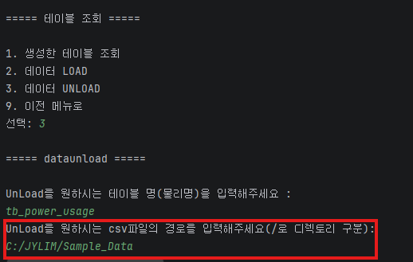

[기능 표로 돌아가기](#주요-내용-및-기능)
